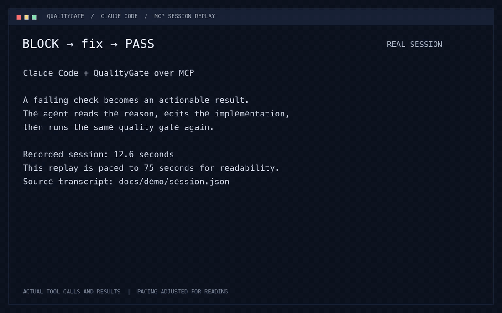

# QualityGate

QualityGate runs your project's checks and gives developers, CI and AI agents the
same PASS/BLOCK verdict, failure reasons and saved evidence through a CLI and MCP.



**[Watch the 75-second demo](docs/demo/qualitygate-claude-code.mp4)** ·
[Actual session transcript](docs/demo/session.json) · [Reproduce it](examples/agent-fix/)

Claude Code calls `run_gates`, reads the failing test output, fixes a sign error,
and calls the same MCP tool again. Tests and configuration stay unchanged. The GIF
and video replay a real Claude Code session with pauses paced for readability;
they are not a capture of the interactive Claude Code TUI.

[Vision](VISION.md) · [Contributing](CONTRIBUTING.md) · [Security](SECURITY.md) ·
[Verification](docs/VERIFICATION.md) · [Environments](docs/ENVIRONMENTS.md) · [Agent integrations](docs/INTEGRATIONS.md)
· [Architecture](docs/ARCHITECTURE.md)
· [SonarQube and security review](docs/SECURITY_REVIEW.md)

**Status:** working developer preview for local use and CI. The CLI, React UI,
TS/JS and Python analysis, real Chrome audits and local package installs are
verified. Claude Code has a recorded end-to-end demo. Other editor configurations
and model adapters have automated contract tests; live Cursor/Codex sessions and
Ollama/vLLM inference remain experimental. See the [verification record](docs/VERIFICATION.md).

Optional SonarQube gates wait for the specific scanner analysis and save its gate
conditions as evidence. External review methodologies can be pinned, updated and
read through MCP; configured review producers return structured findings into the
same report. These adapters have contract tests; live SonarQube compatibility and
a complete Cloudflare multi-agent audit remain unverified. See the
[setup and execution boundaries](docs/SECURITY_REVIEW.md).

## Local workspace and code analysis

The Node.js/TypeScript monorepo also includes a [React dashboard](packages/dashboard/README.md)
and a reusable [code-analysis package](packages/code-analysis/README.md) for TS/JS
and Python. The analyzer detects complex functions and code smells using ESLint,
SonarJS and Ruff, with locations and saved evidence through QualityGate.

```sh
pnpm build
pnpm dashboard --config .qualitygate.yml
pnpm analyze
node packages/code-analysis/dist/cli.mjs --language python /path/to/project --json
```

Open http://127.0.0.1:4173 to run/cancel checks and inspect the latest result.
See the [working Python example](examples/python-project/) for Ruff + unittest
gates. Python analysis and the complete repository test suite require Ruff on PATH;
the verified version is `0.9.2` (`uv tool install ruff==0.9.2`).

`pnpm test:coverage` produces HTML, JSON and LCOV in `coverage/` and enforces the
coverage thresholds in [.c8rc.json](.c8rc.json). Coverage includes the CLI, core,
plugins, model adapters, code analyzer, dashboard API and React components. Only
the SDK file containing TypeScript interfaces without runtime code is excluded.

## Quickstart

Requires Node **22.19+** and **pnpm 11.5.1**; the repository's self-check tests also
require Ruff **0.9.2** on PATH. Chrome is only needed for URL audits;
set `CHROME_PATH` to select an executable when discovery fails.

```sh
git clone https://github.com/example-org/qualitygate.git
cd qualitygate
nvm install
nvm use
corepack enable
pnpm install --frozen-lockfile
# Required for the Python adapter and the repository's own test gate:
uv tool install ruff==0.9.2
pnpm build
pnpm dashboard
```

If you do not use uv, install the same Ruff version using one of the
[official installation methods](https://docs.astral.sh/ruff/installation/).
Open **http://127.0.0.1:4173** and click **Run quality gates** to check this
repository's lint, types, complexity and test coverage. CLI equivalent:
`node dist/qualitygate.mjs run`. Exit 0 means PASS.

If you manage Node without nvm, select the version in [.nvmrc](.nvmrc) with your
preferred manager. pnpm is pinned by `packageManager` in `package.json`; CI reads
those same files. [.npmrc](.npmrc) configures npm; pnpm 11 reads the matching
`engineStrict` / `saveExact` settings from [pnpm-workspace.yaml](pnpm-workspace.yaml).
They enforce supported Node engines during install and save exact dependency
versions. Commit the lockfile for reproducible installs.

Repository installs require **pnpm 11.5.1**. `devEngines.packageManager` rejects
npm in the source checkout, the preinstall guard also rejects other managers or
versions, and pnpm uses `pmOnFail: error` for a version mismatch. The guard has no
downloaded dependencies. Installing the packaged CLI in another project does not
impose this repository's package manager on its consumers.

Registry dependencies must be at least **seven days old** (`minimumReleaseAge:
10080`, in minutes). `minimumReleaseAgeStrict: true` fails when there is no eligible
version; there are no age exclusions. This policy applies to direct/transitive
resolution and lockfile verification. It delays new releases; it is not a malware
scan or a replacement for reviewing dependency updates.

## Technology stack

Versions below match the current manifests and verified external-tool setup.

| Area | Technology / version | Purpose |
| --- | --- | --- |
| Runtime | Node.js 22.19.0 | CLI, runner, MCP and local HTTP API |
| Language | TypeScript 5.9.3 | Strict types and plugin contracts |
| Monorepo | pnpm 11.5.1 workspaces | Package management and frozen lockfile |
| Frontend | React / React DOM 19.2.0, CSS | Local dashboard |
| Build | esbuild 0.25.10, tsx 4.20.6 | Bundles and source execution |
| Contracts | Zod 3.25.76, YAML 2.8.1 | Runtime validation and project configuration |
| TS/JS analysis | ESLint 9.37.0, typescript-eslint 8.46.1, SonarJS 4.2.2 | Lint, complexity and code smells |
| Python analysis | Ruff 0.9.2 (external executable) | Python lint and McCabe complexity |
| Web audits | Lighthouse 12.8.2, chrome-launcher 1.0.0 | Real Chrome audits and normalized scores |
| Agent protocol | MCP SDK 1.32.1 | Stdio tools for agent clients |
| Model adapters | Ollama / vLLM / chat-compatible HTTP | Bounded tool calling; live inference experimental |
| Tests | node:test, jsdom 26.1.0, React act | Core, integration and component tests |
| Coverage | c8 10.1.3 / V8 | HTML, JSON and LCOV with enforced thresholds |
| Browser tests | Puppeteer Core 24.43.1 + Chrome | Real dashboard and workflow verification |
| CI / Linux checks | GitHub Actions, local Docker | Automated checks and isolated Linux reproduction |
| Storage | Filesystem, JSON and logs | Per-run evidence and atomic reports |

Workspace layout: [pnpm-workspace.yaml](pnpm-workspace.yaml). Exact dependency
resolution: [pnpm-lock.yaml](pnpm-lock.yaml). Verified Chrome/OS versions:
[environment matrix](docs/ENVIRONMENTS.md).
Lint, types, complexity and coverage configuration, including how a target project
uses its own rules: [code-quality policy](docs/CODE_QUALITY.md).

## Check another project

For GitHub Actions, GitLab CI and Bitbucket Pipelines, see the
[CI templates and managed PR/MR report setup](docs/CI.md). Existing descriptions
are preserved as manual text; later runs replace only the tagged report block.

Create `.qualitygate.yml` in the target project and choose its actual check commands:

```yaml
schemaVersion: 1
gates:
  - id: lint
    run: pnpm lint
  - id: test
    run: pnpm test
    timeoutMs: 300000
outputDir: .qualitygate
```

Run the built CLI with `--config /path/to/project/.qualitygate.yml`. Commands run in
the config file's directory. Run a subset with `--gate lint --gate test`, or use
`--json` for one machine-readable result on stdout.

From the QualityGate checkout, open a dashboard for that project:

```sh
pnpm dashboard --config /path/to/project/.qualitygate.yml --port 4174
```

Open http://127.0.0.1:4174. One dashboard instance uses one selected project.
The UI runs from this monorepo; the root CLI tarball is a separate installation.
For Python analysis plus real project tests, use the [Python example](examples/python-project/).

**Gate commands are not sandboxed.** They run through the system shell with your
permissions and inherited environment. Review configuration before running checks,
including through MCP. See [SECURITY.md](SECURITY.md) for the execution boundary.

## Connect Claude Code through MCP

Generate a snippet with the correct executable paths:

```sh
node dist/qualitygate.mjs connect --client claude --config /path/to/project/.qualitygate.yml
```

Merge the printed snippet into the client's settings; the command never overwrites
them. Cursor, Codex and other client formats are listed in [integrations](docs/INTEGRATIONS.md).

After building, add `.mcp.json` to the project you want to check. Use absolute paths
for the built CLI and that project's config:

```json
{
  "mcpServers": {
    "qualitygate": {
      "command": "node",
      "args": [
        "/absolute/path/to/qualitygate/dist/qualitygate.mjs",
        "mcp", "--config", "/absolute/path/to/project/.qualitygate.yml"
      ]
    }
  }
}
```

Ask Claude Code: **"Run QualityGate before editing. If it returns BLOCK, read the
failure, fix the implementation, then run it again. Keep tests and policy unchanged."**

| MCP tool | Result |
| --- | --- |
| `list_gates` | Configured gate IDs, commands, URLs and thresholds |
| `run_gates` | Run all gates or selected IDs; return verdict and failure output |
| `get_run` | Inspect a stored run by ID, or the latest run |

Tools accept no arbitrary command, path or URL: they use the selected configuration.
The configured commands and local plugins remain trusted code. The same run schema
and policy apply to CLI and MCP. Passing gate logs are omitted from MCP output;
failing gate output includes a bounded tail and a path to the full log.

## Lighthouse audits

Create a URL config without overwriting existing files:

```sh
node dist/qualitygate.mjs init https://example.com --config web-qualitygate.yml
node dist/qualitygate.mjs run --config web-qualitygate.yml
```

```yaml
schemaVersion: 1
urls:
  - http://127.0.0.1:4173
thresholds:
  performance: 80
  accessibility: 90
  seo: 90
  best-practices: 90
outputDir: .qualitygate
timeoutMs: 120000
```

Command gates and URL audits can share one config. Scores use 0–100 and each
category threshold is explicit. An absent required metric blocks the result.
URLs run sequentially; errors are retained per URL.

For a local example, keep `pnpm fixture` running in another terminal and point the
config at `http://127.0.0.1:4173`. Set all thresholds to zero for PASS. Set `seo: 100`
for BLOCK: the fixture deliberately omits a meta description. Zero thresholds are
for the demonstration; missing metrics still block. Policy evaluation is deterministic
for the same saved scores and thresholds; Lighthouse measurements can vary by run.

## How it differs from Lighthouse CI and SonarQube

| Tool | Primary role |
| --- | --- |
| [Lighthouse CI](https://github.com/GoogleChrome/lighthouse-ci/blob/main/docs/configuration.md) | Collect Lighthouse audits, assert budgets and thresholds, and upload reports in CI |
| [SonarQube](https://docs.sonarsource.com/sonarqube-server/quality-standards-administration/managing-quality-gates/introduction-to-quality-gates) | Analyze code and apply quality gates to analysis metrics such as reliability, security and coverage |
| QualityGate | Run existing project commands and Lighthouse locally; expose one stored verdict and actionable failure output to CLI, CI and MCP clients |

QualityGate focuses on the agent feedback loop: check, read the reason, fix, check
again. It can invoke existing analyzers through command gates. It does not implement
SonarQube's full analysis platform or Lighthouse CI's report-history service.
The ESLint report adapter and saved-run inspection are implemented; dedicated
Vitest/coverage parsing and richer history remain follow-up work tracked in
[issue #1](https://github.com/example-org/qualitygate/issues/1) and
[issue #2](https://github.com/example-org/qualitygate/issues/2).

## Results, evidence and exit codes

Each run gets a unique ID and saves `.qualitygate/<runId>/report.json`. Raw Lighthouse
JSON and full command logs are stored beside it. Report paths resolve relative to
the config file. Ordinary output shows scores, errors and paths; `--json` emits a
versioned JSON result. Command log tails are limited to 4 KB in the report.

| Exit | Meaning |
| --- | --- |
| 0 | Completed, PASS |
| 1 | Completed, BLOCK |
| 2 | Configuration, browser, command execution, cleanup or storage error |
| 130 | SIGINT or SIGTERM interruption |

Execution status and policy decision are separate. Errors take precedence over
BLOCK, and failure on a later URL or gate preserves earlier results. Timeouts and
interruptions stop owned process groups and save a summary when storage is available.
Chrome startup waits for launch settlement before cleanup; its default connection
budget is 10 seconds, bounded by the audit timeout. Cleanup waits for the owned
process to exit before profile removal. When storage rejects writes, the result records the
error; a saved report cannot be guaranteed.

## Development and installation checks

```sh
pnpm check           # Lint, types, complexity, enforced test coverage and build
pnpm verify:clean    # Fresh install from the lockfile and all checks
pnpm smoke           # Real Chrome: PASS/BLOCK, errors, timeout and Ctrl+C
pnpm verify:package  # Local tarball install and real Chrome smoke
pnpm verify:analysis-package # Standalone analyzer API/CLI tarball: TS + Python
pnpm smoke:dashboard # Real Chrome: documented dashboard command, BLOCK → fix → PASS
pnpm verify:release  # Sequential local acceptance check before a GitHub update
```

CI is configured to provision Ruff/Chrome, run these checks and upload evidence
and coverage. Remote CI status is separate from the local verification record.
The CLI is tested from a local tarball; this does not publish a package to npm:

```sh
mkdir -p /tmp/qualitygate-demo
pnpm pack --pack-destination /tmp/qualitygate-demo
cd /tmp/qualitygate-demo
npm install --prefix ./install ./qualitygate-prototype-0.1.0.tgz
./install/node_modules/.bin/qualitygate --help
```

Maintained source lives under `packages/`. The original service is archived in
[`legacy/lighthouse-v1/`](legacy/lighthouse-v1/) with separate dependencies and its
original ISC license. It is excluded from the workspace and CLI package.
QualityGate is licensed under [MIT](LICENSE). The local React dashboard is included;
desktop and Ink remain outside this release.
