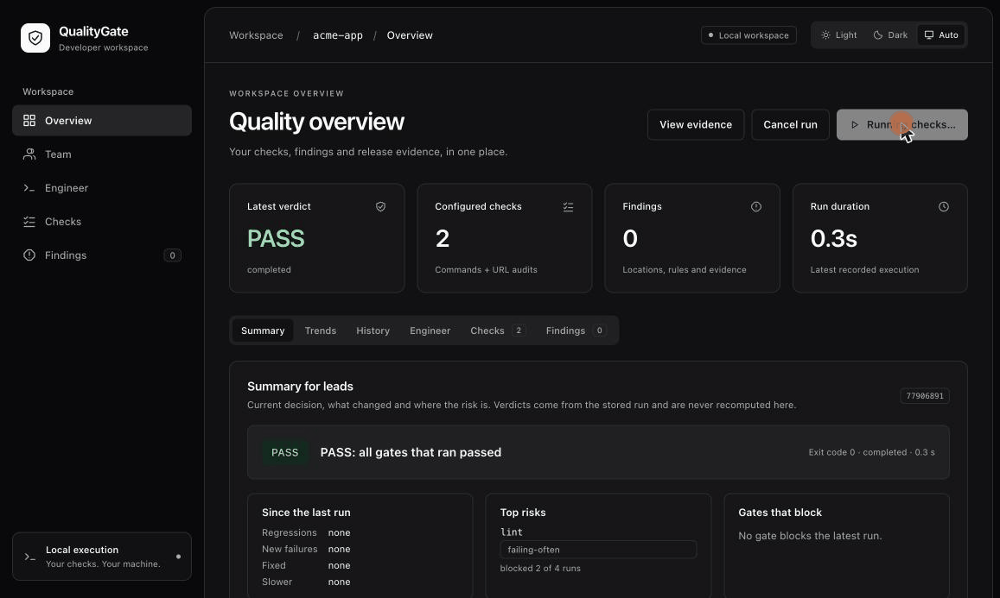
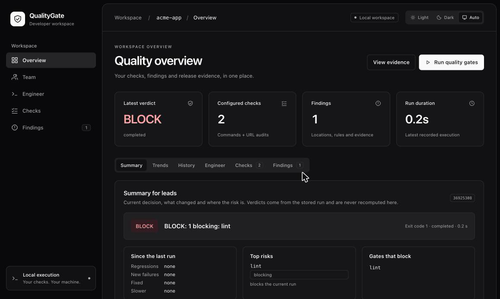
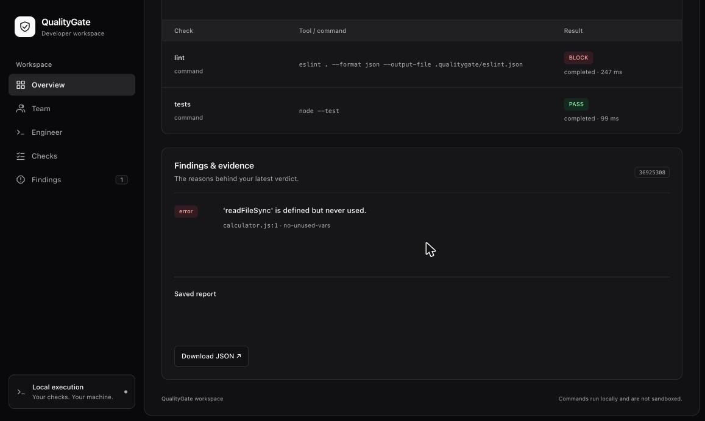
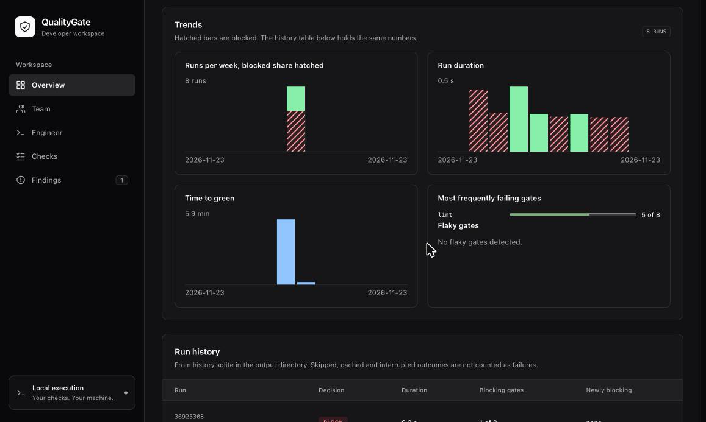
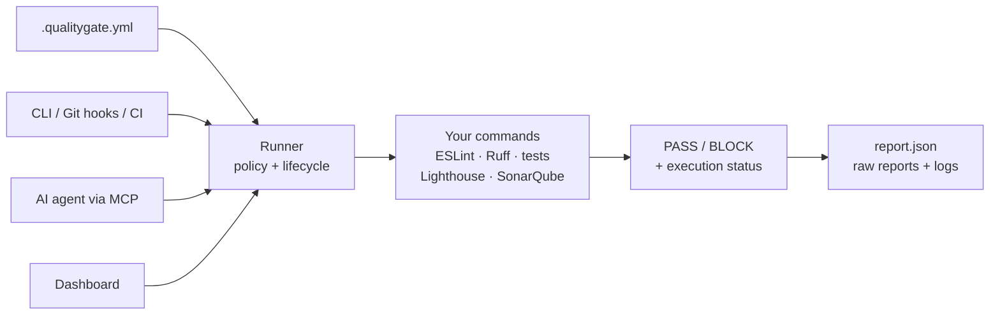

# QualityGate

QualityGate runs your project's existing checks (lint, types, tests, scanners, Lighthouse) and gives
developers, CI and AI agents **one PASS / BLOCK decision**, findings you can act on and saved evidence.

**Local-first · CLI + MCP + React dashboard · TypeScript / JavaScript / Python / PHP / Unity · MIT**



*The local dashboard on a small demo project (`acme-app`): ESLint reports an unused import, the verdict is BLOCK;
after the fix the same run is PASS.*

## Why

Lint, tests and scanners already do useful work, but their commands, thresholds and reports end up spread
across scripts, CI jobs and agent prompts. QualityGate puts the **decision and its evidence** behind one
project-owned file.

- **One configuration** for local runs, Git hooks, CI and MCP.
- **A reason to act on:** file, line, rule and message when the tool reports them.
- **Evidence:** raw reports and logs are kept next to the normalized result.
- **Honest failures:** a broken tool, a missing report or a timeout never turns into a green run.

The loop is **check → read the cause → fix → check again**. Your existing tools keep doing the analysis.

## What you see

| Verdict and summary | The reason, with file and line |
| --- | --- |
|  |  |

Every run is stored locally, so the dashboard also shows trends: blocked share per week, run duration,
time to green, and the gates that fail or flake most often.

<details>
<summary>Run history and trends</summary>



</details>

The same decision is available in the terminal (`qualitygate run`), in CI, through MCP for AI agents and in a
Chrome extension. A [recorded Claude Code session](docs/demo/qualitygate-claude-code.mp4) shows an agent reading a
BLOCK, fixing the code and getting PASS; [the transcript](docs/demo/session.json) and
[a reproducible example](examples/agent-fix/) are in the repository.

## Quick start

QualityGate is not on npm yet. Build it from a checkout (Node 22.23.4+, pnpm 11.28.9):

```sh
pnpm install --frozen-lockfile
pnpm build
pnpm pack:local                  # writes .packages/<version>/qualitygate-toolbox-<version>.tgz
```

In the project you want to check, install the tarball, let QualityGate propose its gates and run them:

```sh
pnpm add -D ./tools/qualitygate-toolbox-0.1.0.tgz
pnpm exec qualitygate setup      # detects Node, Python, PHP, Unity, Playwright, Maestro; writes .qualitygate.yml
pnpm exec qualitygate run
```

A minimal `.qualitygate.yml`:

```yaml
schemaVersion: 1
gates:
  - id: lint
    run: pnpm run lint
  - id: typecheck
    run: pnpm run typecheck
  - id: tests
    run: pnpm run test:ci
    timeoutMs: 300000
outputDir: .qualitygate
```

Step-by-step install, report formats and monorepo notes: [usage guide](docs/USAGE.md#add-to-an-existing-project).

## Commands

| Command | What it does |
| --- | --- |
| `qualitygate run [--gate <id>] [--json]` | Run the gates and print the decision. `--changed` and `--cache` skip work that cannot have changed |
| `qualitygate fix` | Run the fixers a gate declares, then re-run the same gates; the re-run decides |
| `qualitygate list` / `doctor` | Show the configured gates and whether this machine can run them |
| `qualitygate history` / `trends` / `prune` | Compare runs, see flaky and failing gates, trim the local history |
| `qualitygate ui` | Interactive terminal screen over the same runner |
| `qualitygate export --out report/` | One self-contained HTML report |
| `qualitygate connect --client claude` | Print the MCP configuration for an editor agent |
| `qualitygate bridge` | Authenticated local API on 127.0.0.1 for the extension and desktop client |

### Exit codes

| Exit | Meaning |
| --- | --- |
| `0` | PASS |
| `1` | BLOCK |
| `2` | Configuration, execution or storage error |
| `3` | A gate timed out |
| `130` | Interrupted |

A fixer, a client or a cached result never changes a verdict. Details: [results and exit codes](docs/USAGE.md#results-and-exit-codes).

## How it works



Independent gates run in parallel (`concurrency: 4`). Every run is saved under `.qualitygate/<run-id>/` and
appended to a local SQLite history. See [architecture](docs/ARCHITECTURE.md).

## Where you can use it

| Where | How | Guide |
| --- | --- | --- |
| Terminal | `qualitygate run`, `fix`, `ui` | [usage](docs/USAGE.md) |
| CI | Same command, same exit codes; templates for GitHub Actions, GitLab CI and Bitbucket | [CI](docs/USAGE.md#run-in-ci), [CI.md](docs/CI.md) |
| Git hooks | Husky `pre-commit` and `pre-push` | [hooks](docs/USAGE.md#attach-to-git-with-husky) |
| AI agents | Stdio MCP server: `list_gates`, `run_gates`, `get_run` | [agents](docs/USAGE.md#connect-an-agent), [integrations](docs/INTEGRATIONS.md) |
| Dashboard | Local React dashboard with run history, trends and a team view | [dashboard](packages/dashboard/README.md), [for teams](docs/FOR-TEAMS.md) |
| Chrome | Manifest V3 extension that scans the current tab through the bridge | [extension](docs/CHROME_EXTENSION.md) |
| Desktop | Tauri wrapper around the dashboard (prototype) | [desktop](docs/DESKTOP.md) |
| Visual regression | Optional plugin: screenshots against approved baselines | [visual regression](docs/VISUAL_REGRESSION.md) |

## Status

A **working developer preview**, verified locally rather than on every provider and OS.

- Tested: CLI and packaging, real Chrome runs, the dashboard, Husky hooks, the bridge, the extension.
  Desktop builds unsigned on macOS and Windows in CI. Gates have run against Unity, Node and Python projects.
- Not verified yet: live Cursor/Codex sessions, Ollama/vLLM inference, live SonarQube, PHP projects,
  a Windows desktop run by hand.
- Not published: no npm package, no signed desktop build, no Chrome Web Store listing.

Evidence and open items: [verification](docs/VERIFICATION.md), [environment matrix](docs/ENVIRONMENTS.md), [roadmap](TODO.md).

```sh
pnpm check            # lint, types, complexity, enforced coverage, build
pnpm smoke:dashboard  # real Chrome: BLOCK → fix → PASS
```

## Documentation

[Usage guide](docs/USAGE.md) · [Project setup](docs/PROJECT_SETUP.md) · [Architecture](docs/ARCHITECTURE.md) ·
[CI and PR reporting](docs/CI.md) · [Bridge API](docs/BRIDGE.md) · [Integrations](docs/INTEGRATIONS.md) ·
[Security review](docs/SECURITY_REVIEW.md) · [Threat model](docs/threat-model/README.md) · [Vision](VISION.md)

## Security, contributing and license

**Gate commands are trusted code and are not sandboxed.** They inherit your permissions and environment.
The dashboard has no authentication and belongs on loopback only. Private reporting: [SECURITY.md](SECURITY.md).
Contributions: [CONTRIBUTING.md](CONTRIBUTING.md).

MIT licensed, see [LICENSE](LICENSE). Copyright (c) 2026 QualityGate contributors; keep the notice in copies and forks.
