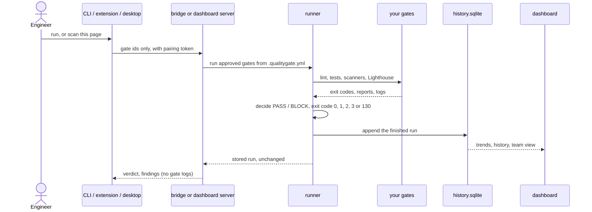

# QualityGate for teams

One page for three readers: team leads, engineering managers and engineers. Every command and path below exists in
this repository. Things that are not built or not verified are marked **unverified** or **not built**.

Two facts shape everything here:

- The verdict (PASS, BLOCK, error, timeout, interrupted) and its exit code (`0`, `1`, `2`, `3`, `130`) come from the
  runner. The dashboard, the bridge, the Chrome extension and the desktop prototype only display it. None of them can
  turn a BLOCK into a PASS.
- History is a **local file** (`<outputDir>/history.sqlite`, default `.qualitygate/history.sqlite`). It records the runs
  made on the machine that owns it. CI jobs do not share it unless you persist that folder yourself. See
  [what the numbers mean](#what-the-numbers-do-and-do-not-mean).



## Team leads

### What the Summary panel answers

Start `pnpm dashboard --config /absolute/path/.qualitygate.yml` (from the QualityGate checkout; the dashboard is not in the
CLI tarball) and open the team view under the overview cards. The summary answers:

| Question | Where it comes from |
| --- | --- |
| Is the project green right now? | Decision and exit code of the latest stored run, copied, not recomputed |
| What changed since the previous run? | Regressions (passed before, blocks now), new failures, fixed gates, newly slow gates |
| What should we look at first? | Top 3 risks: regressions, blocking gates, flaky gates, often failing gates, slower gates |
| Which gates block? | The failing gates, each with its findings (see the engineer view) |
| How fast do we recover? | Median time to green (BLOCK to the next PASS) |

Same data, no browser: `qualitygate history` and `qualitygate trends`. The summary can be copied or downloaded as
Markdown for stand-ups and PR descriptions. Gate output and evidence paths are never part of it, so a secret scanner's
log cannot leak into the summary. Details: [packages/dashboard/README.md](../packages/dashboard/README.md#team-view).

Every step is listed, so "PASS" built from 3 of 30 gates reads "3 of 30 steps ran" (the step registry in `report.json`).
Check that line before you trust a green result.

### PR checks and branch protection

Run the CLI as a normal CI job: the job fails when `qualitygate run` exits non-zero, and branch protection then blocks
the merge. Copyable templates: [GitHub Actions](../examples/ci/github-actions.yml),
[GitLab CI](../examples/ci/gitlab-ci.yml), [Bitbucket Pipelines](../examples/ci/bitbucket-pipelines.yml). Explanation
and trust rules: [CI and PR/MR reporting](CI.md).

1. Copy the template for your platform and keep the exit code (never `|| true`).
2. Optional, in a separate trusted job that holds the write token: `qualitygate pr`, `qualitygate comment` (one sticky
   PR comment), `qualitygate status` (GitHub commit status, context `qualitygate`) and `qualitygate notify` (Slack, BLOCK
   or error only). Each prints a dry run until you add `--write`. Fork PRs are refused.
3. In the repository settings mark the QualityGate job (and/or the `qualitygate` status) as a **required status check**
   on your protected branch. That is a setting in GitHub, GitLab or Bitbucket; this repository cannot do it for you and
   has not verified it against a live provider (live pipeline execution is listed as unverified in the README).
4. Developers can run the same gates before pushing, with [Husky hooks](../examples/hooks/README.md). Hooks can be
   bypassed; CI is the enforcement point.

### SARIF and Code Scanning

```sh
pnpm exec qualitygate run --json > result.json      # keep the run's exit code in CI
pnpm exec qualitygate report --input result.json --sarif --output qualitygate.sarif
```

The SARIF 2.1.0 file can be uploaded with `github/codeql-action/upload-sarif`. The shipped GitHub template does **not**
contain that upload step; add it yourself. Findings that have no repo-relative file (for example an accessibility
violation that has only a CSS selector) carry no location and may not show up in Code Scanning, so keep the Markdown
report as well. Known gaps (paths resolved against the working directory, `skip:` gates not reported as notes) are
tracked as T-088. Uploading to GitHub Code Scanning was not exercised against a live repository here.

## Engineering managers

### Trends, flaky gates, time to green, regressions

`qualitygate trends [--limit 50] [--json]` and the dashboard's trends section show, over the last N recorded runs:

- **Blocks per week** and the blocked share of runs, plus run duration.
- **Most frequently failing gates.**
- **Flaky gates**: a gate that flips between PASS and BLOCK at least twice with no change of its input hash. A gate that
  declares no `inputs` has no hash, so every flip counts. Declare `inputs: [globs]` on a gate to make this signal
  meaningful (T-089 tracks making it stricter).
- **Time to green**: from the start of the first blocked run of a streak to the finish of the next PASS; the median over
  completed recoveries, and "blocked since" for a streak that is still open. Interrupted runs are skipped.

`qualitygate history [--limit 10]` compares the newest run with the previous one: **regression** (passed, now failed,
timeout or error), **new failure**, **fixed**, **newly slow** (at least twice as long and one second longer). Both
commands exit `0` even when they report a regression; they never gate anything.

### Exporting a report

- Markdown for a stand-up or PR: the "Export" control in the dashboard team view, or
  `pnpm exec qualitygate report --input result.json --output report.md` for a single run.
- A self-contained HTML page: `qualitygate export --out report/` writes `index.html` and `report.json` with inline CSS,
  no scripts and no network resources, and includes the trends when history exists. It contains command output and file
  paths, so publish it only where the project's logs may be read.
- A live, read-only view: `pnpm dashboard --tunnel cloudflare|ngrok` through your own installed tunnel tool. Anyone with
  the link can read logs and findings.

### What the numbers do and do not mean

- They describe **runs recorded on one machine** (or one persisted `.qualitygate` folder). They are not a company-wide
  or CI-wide metric, and runs from different developers' laptops are not merged.
- A scan from the Chrome extension or the bridge is **not** written to history, so page scans do not distort trends.
- Time to green measures wall-clock time between recorded runs. It includes waiting, nights and weekends, and it does
  not know when work started. Treat it as a rough recovery signal, not as developer productivity.
- A flaky flag is a hint. It needs `inputs` hashes to separate real flakiness from a genuine code change.
- Fewer blocks can mean better code or fewer gates. The step registry tells you how many gates ran.
- Nothing here ranks or attributes results to people. Do not use it that way.
- History is never pruned and never uploaded; delete the file to start over. If it cannot be written, `run` warns on
  stderr and keeps its result and exit code. Pruning, filters and a chosen baseline are open work (T-085).

## Engineers

### Setup

Prerequisites and the local tarball install are in [PROJECT_SETUP.md](PROJECT_SETUP.md) (the CLI is not published to
npm). Then, in your project:

```sh
pnpm exec qualitygate setup        # writes .qualitygate.yml, lists the files it changed
pnpm exec qualitygate run
```

`setup` asks every built-in ecosystem plugin what it finds, never overwrites an existing config and lists anything it
found but did not enable (slow, needs a browser or an emulator) as comments in the file.

| Stack | What `setup` proposes |
| --- | --- |
| Node / TypeScript / JavaScript | `lint`, `typecheck` (or `tsc --noEmit` for a TS project without that script), `test:ci` / `test` and other `test:*` scripts, pnpm/yarn/npm workspaces, `vitest*.config`; ESLint, Vitest and `node --test` get a JSON/JUnit report so findings carry file and line |
| Python | `ruff check .`, `pytest --junitxml`, `mypy .` when the project mentions it |
| PHP | from `composer.json`: Pint, PHP-CS-Fixer or PHPCS; PHPStan or Psalm; PHPUnit or Pest with a JUnit report; Composer scripts as a fallback |

PHP, Unity, Playwright and Maestro detection are covered by the repository's tests against fixtures; they have not
been run against your project, so read the proposal and edit it. Use a terminating test command, not watch mode. A
project that already lists its gates can import them: `qualitygate setup --from gates.json`.

### Running locally with the live view

```sh
pnpm exec qualitygate run                        # all gates
pnpm exec qualitygate run --only lint --only typecheck
pnpm exec qualitygate run --changed              # gates whose `inputs` match changed files
pnpm exec qualitygate run --cache                # skip gates whose inputs did not change since they last passed
```

In an interactive terminal `run` redraws one row per gate (waiting, running with elapsed seconds and the last output
line, then PASS or BLOCK). `--no-live`, `QUALITYGATE_NO_LIVE=1`, a pipe, `CI`, `TERM=dumb` and `--json` turn it off; the
result and exit code are the same either way. Ctrl+C cancels the gates (exit `130`). The output of a secret scanner such
as `gitleaks` is not shown live.

For the browser view: `pnpm dashboard --config /absolute/path/.qualitygate.yml` and open `http://127.0.0.1:4173`, or
`pnpm dev:ui` for the named `qualitygate.localhost` URL (from the QualityGate checkout).

### Reading findings

Findings print as `file:line` with the rule and message when the tool gives structured output (ESLint JSON, JUnit,
Playwright JSON, Ruff, axe, npm-audit, osv-scanner, gitleaks, SARIF export). In the dashboard's engineer view each
blocking gate lists its findings (errors first, ten at most) and a command to run only that gate again, for example
`qualitygate run --gate lint`. A `timeout` is reported as `TIMEOUT` (exit `3`) with the partial counts the report
showed, and is not a tool crash. Raw reports and logs stay in `.qualitygate/<run-id>/`; `qualitygate inspect [runId]`
prints a saved run.

### Chrome extension

Checks the page you are looking at against the project's Lighthouse thresholds, through the local bridge.

```sh
pnpm build
pnpm exec qualitygate bridge --config .qualitygate.yml   # prints a pairing code; default port 4180
```

Then load `packages/chrome-extension/dist` unpacked in `chrome://extensions` (Developer mode), click the toolbar icon on
the page, enter the pairing code once, tick the per-scan consent box and press **Run scan**. Permissions are
`activeTab` and `storage` only; the page content is never read. Lighthouse does not use your signed-in session. The
extension needs a project with Lighthouse `thresholds` in its config. Verified in real Chrome with
`pnpm smoke:extension`. **Not built**: a DevTools panel, screenshot thumbnails and a dashboard run deep link. **Unverified**:
that a real toolbar click grants `activeTab` (the smoke test cannot do that click). **Not done**: Chrome Web Store
package and submission. See [CHROME_EXTENSION.md](CHROME_EXTENSION.md).

### Desktop app

`packages/desktop` is a prototype: a project picker with recent projects, a permission prompt before the bridge starts,
opt-in notifications and buttons that open the report folder. Its TypeScript host and launcher page are unit and
integration tested (including against the real bridge). The Rust/Tauri shell **builds and starts on macOS** (unsigned),
but nothing was clicked through in its webview, and no signed or notarized package exists. There is no installer to
download; treat it as not usable by end users yet. What you can run today is the host:
`pnpm build:desktop`, then see [DESKTOP.md](DESKTOP.md). Signing plan: [DESKTOP_SIGNING.md](DESKTOP_SIGNING.md).

### Security in one paragraph

The bridge binds to `127.0.0.1`, pairs with a one-time code shown only in your terminal, pins each token to the origin
that paired, validates `Origin` and `Host`, and accepts only gate ids that already exist in `.qualitygate.yml` or an
`http(s)` URL to scan. There is no way to send a command, a path or a config. Gate output and command lines are never
returned to clients. Gate commands themselves are trusted code and are not sandboxed. See [BRIDGE.md](BRIDGE.md) and
[SECURITY.md](../SECURITY.md).
